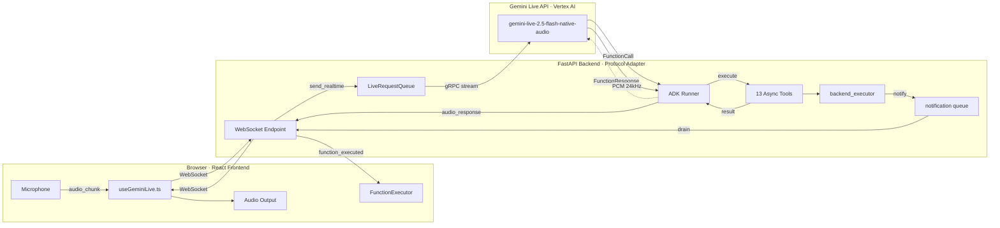

# AI Voice Agent — Technical Architecture

## 1. Overview

The AI Voice Agent is a real-time, multimodal voice assistant built on Google's ADK (Agent Development Kit) and Gemini Live API. It enables natural voice conversations that drive a full e-commerce bookshop experience: users speak to browse books, manage a shopping cart, and complete purchases — all without touching a keyboard.

**Tech stack:**
- **Backend**: Python / FastAPI + Google ADK
- **Frontend**: React 18 / TypeScript
- **AI**: Gemini Live native-audio model (bidirectional voice streaming + function calling)

---

## 2. Core Architecture



The backend is a **protocol adapter** — it bridges the frontend's simple JSON WebSocket protocol with ADK's `Runner`/`LiveRequestQueue` streaming interface. No business logic lives in the WebSocket layer itself.

**ADK's abstraction layer** shields the backend from raw Live API WebSocket protocol details — connection setup, function call/response framing, audio chunking, VAD signaling, and session tokens are all handled internally. ADK exposes only `LiveRequestQueue` (send side) and `run_live()` event generator (receive side). See the [ADK Streaming Dev Guide](https://google.github.io/adk-docs/streaming/dev-guide/part1/) for the full architecture walkthrough.

---

## 3. Component Map

### A. Backend

| File | Role |
|---|---|
| `main.py` | FastAPI app entry point, CORS, router registration |
| `app/agent.py` | ADK `Agent` definition — model, instruction, tools, tool config |
| `app/api/websocket.py` | WebSocket endpoint — upstream/downstream async tasks |
| `app/config/settings.py` | Pydantic Settings — env vars, YAML agent config |
| `app/config/agent_config.yaml` | System instruction, voice name, response modalities |
| `app/tools/ecommerce_tools.py` | 14 tool function definitions (ADK-registered) |
| `app/tools/backend_executor.py` | Business logic for every tool (catalog, cart, user) |
| `app/tools/notifications.py` | In-process queue: backend → WebSocket → frontend |
| `app/tools/cart_cache.py` | In-memory per-session cart state |
| `app/tools/user_cache.py` | In-memory per-session user info |
| `app/data/catalog.py` | Book catalog loader (`books-enriched.json`) |

### B. Frontend

| File | Role |
|---|---|
| `src/hooks/useGeminiLive.ts` | WebSocket connection, audio capture/playback, state |
| `src/services/functionExecutor.ts` | Handles `function_executed` messages for UI sync |
| `src/pages/` | Home, Book, Cart, Register, Checkout pages |

---

## 4. ADK Agent Setup

The agent is defined in `app/agent.py` using Google ADK's `Agent` class:

```python
agent = Agent(
    name="bookshop_voice_assistant",
    model=settings.ai_model_name,           # gemini-live-2.5-flash-native-audio
    instruction=settings.agent_config.system_instruction,
    tools=ECOMMERCE_TOOLS,
    generate_content_config=types.GenerateContentConfig(
        tool_config=types.ToolConfig(
            function_calling_config=types.FunctionCallingConfig(
                mode=types.FunctionCallingConfigMode.AUTO
            )
        )
    ),
)
```

**Why `generate_content_config` is required:** Native-audio Gemini models do not activate function calling by default — without an explicit `FunctionCallingConfig(mode=AUTO)`, the model describes what it would do in spoken audio instead of emitting actual function call parts. This config forces the model into proper tool-use mode. See [Gemini 2.5 Flash Live API](https://docs.cloud.google.com/vertex-ai/generative-ai/docs/models/gemini/2-5-flash-live-api) for model-level configuration details.

### RunConfig

`RunConfig` is session-specific — each `run_live()` call can have different settings. Key options:

```python
RunConfig(
    response_modalities=["AUDIO"],
    output_audio_transcription=AudioTranscriptionConfig(),  # enables assistant transcript events
    input_audio_transcription=AudioTranscriptionConfig(),   # enables user transcript events
    # session_resumption=SessionResumptionConfig() — not used; each connection starts fresh
)
```

**Important:** `response_modalities=["AUDIO"]` is mandatory for the native-audio model. The native-audio variant does **not** support `response_modalities=["TEXT"]`.

---

## 5. Tool Architecture

### Design principle

All 14 tools are **backend-executed `async def` functions** registered directly with ADK. When the model calls a tool:

1. ADK executes the function on the backend
2. The result is returned to the model through ADK's internal path (no WebSocket round-trip)
3. The backend simultaneously pushes a `function_executed` notification to the frontend for UI sync

### The 14 tools

| Tool | What it does |
|---|---|
| `searchBooks(query, category)` | Searches the local book catalog |
| `getBookDetails(bookId, title)` | Returns full details for a single book |
| `getCartDetails()` | Returns cart contents + user info from backend cache |
| `getCart()` | Alias for `getCartDetails` |
| `addToCart(bookId, quantity)` | Adds a book to the backend cart cache |
| `removeFromCart(bookId, index)` | Removes a book from the cart by ID or position |
| `setUserInfo(name, email, address)` | Stores user info in the backend session cache |
| `focusPasswordField()` | Tells frontend to focus the password field |
| `checkout()` | Validates cart and tells frontend to navigate to /checkout |
| `confirmPurchase()` | Generates order ID, clears cart, completes mock purchase |
| `navigateTo(path)` | Tells frontend to navigate to any path |
| `getViewDetails(bookId)` | Tells frontend to open the book detail page |
| `highlightCapabilities()` | Tells frontend to highlight the capabilities section |
| `highlightWhyVoice()` | Tells frontend to highlight the "Why Voice + LLM?" benefits section |

Function names are camelCase to match the frontend `FunctionExecutor` switch cases exactly. When the user asks why they should use the agent or what the benefits are, the system prompt instructs the agent to call `navigateTo("/")` then `highlightWhyVoice` and summarize the four benefits by voice.

### Execution flow for a typical tool call

```
User: "Add Dune to my cart"
  │
  ▼
Gemini model emits FunctionCall { name: "addToCart", args: { bookId: "42", quantity: 1 } }
  │
  ▼
ADK executes async addToCart("42", 1) on backend
  │
  ├──→ backend_executor.run_add_to_cart() updates cart_cache
  │
  ├──→ notify_frontend("addToCart", params, result) pushes to notification queue
  │
  └──→ Returns { success: true, data: { title: "Dune", ... } } to ADK
            │
            ▼
         ADK feeds result back to Gemini model (internal path)
            │
            ▼
         WebSocket drain_notifications() picks up queued message
            │
            ▼
         Frontend receives { type: "function_executed", name: "addToCart", ... }
            │
            ▼
         FunctionExecutor updates cart UI
```

### Tool call interruption

If the user speaks while a tool call is in flight, the Live API emits a `BidiGenerateContentToolCallCancellation`. ADK surfaces this as an interrupted event — the pending tool result is discarded and the model responds to the user's new input instead. Tool implementations should be idempotent where practical.

---

## 6. WebSocket Protocol

### Messages sent by frontend → backend

| Type | Fields | Purpose |
|---|---|---|
| `audio_chunk` | `data` (base64 PCM) | Raw microphone audio at 16kHz |
| `text` | `text` | Text input (testing/fallback) |

### Messages received by frontend ← backend

| Type | Fields | Purpose |
|---|---|---|
| `connection_status` | `status`, `message` | `connecting` / `connected` / `disconnected` |
| `audio_response` | `data` (base64 PCM) | AI voice output at 24kHz |
| `transcript` | `role`, `text` | Speech-to-text for user and assistant |
| `function_executed` | `name`, `parameters`, `result` | Notification of backend tool execution for UI sync |
| `error` | `message`, `code` | Error from Gemini API or connection loss |

Note: `function_call` and `function_result` messages from the old architecture are no longer used. All tool execution happens on the backend.

---

## 7. Audio Pipeline

### Input (user → model)
1. Browser captures microphone at native rate (typically 48kHz)
2. `useGeminiLive` hook resamples Float32 PCM → 16kHz
3. Converts to 16-bit signed integer (little-endian), base64-encodes
4. Sends as `audio_chunk` WebSocket message
5. Backend decodes and calls `live_queue.send_realtime(types.Blob(mime_type="audio/pcm;rate=16000", ...))`

**Supported Live API input formats:** Raw PCM, AAC, FLAC, MP3, M4A, MPEG, WAV, WebM, OGG. This project uses raw 16-bit PCM at 16kHz for minimum latency.

### Output (model → user)
1. ADK event loop yields events with `part.inline_data` (24kHz PCM, 16-bit, little-endian)
2. Backend base64-encodes and sends as `audio_response`
3. Frontend decodes to Int16Array, creates AudioBuffer, schedules playback

### Voice Activity Detection (VAD)

VAD runs automatically on the backend — the Live API continuously monitors the incoming audio stream and determines when the user starts and stops speaking.

| Setting | Default | Notes |
|---|---|---|
| Start-of-speech sensitivity | Low | Higher = triggers faster |
| End-of-speech sensitivity | High | ~1 second of silence closes a turn |
| Prefix padding | 0ms | Audio before speech detected |

**Barge-in (interruption):** When VAD detects the user speaking mid-response, the ongoing model generation is canceled and discarded. Only audio already delivered to the client is retained in session history. The server then emits an interruption signal before handling the new input.

**Manual VAD override:** Disable automatic VAD via `RealtimeInputConfig.AutomaticActivityDetection.disabled = true` and send explicit `ActivityStart`/`ActivityEnd` signals — useful for push-to-talk or noise-sensitive environments. See [Configure Gemini capabilities](https://docs.cloud.google.com/vertex-ai/generative-ai/docs/live-api/configure-gemini-capabilities) for all VAD and activity handling options.

---

## 8. Session Management

### ADK session vs Live API session

ADK maintains two distinct session concepts:

| Concept | Scope | Managed by |
|---|---|---|
| **ADK Session** | Persistent — can span multiple connections | `InMemorySessionService` (or `DatabaseSessionService` / `VertexAiSessionService`) |
| **Live API session** | Transient — exists only for a single `run_live()` event loop | Gemini Live API |

In this project, both reset on reconnect: each WebSocket connection gets a fresh `user_id` and `session_id` (UUID4).

### Per-session state
- `InMemorySessionService` — ADK conversation history
- `cart_cache` — in-memory per-session cart (keyed by `session_id`)
- `user_cache` — in-memory per-session user info (keyed by `session_id`)

### Session resumption (not currently used)

For production reconnection handling, ADK supports `SessionResumptionConfig()` in `RunConfig`. When enabled, the Live API sends `SessionResumptionUpdate` checkpoints that a client can present on reconnect to restore context — useful for network drop recovery. This project intentionally starts fresh on each connection.

### Session length limit

The Live API enforces a **default maximum session length of 10 minutes**. Sessions approaching this limit receive a `GoAway` message before termination, allowing graceful client-side reconnection logic to be implemented if needed. See the [Live API reference](https://docs.cloud.google.com/vertex-ai/generative-ai/docs/model-reference/multimodal-live) for `GoAway` and `SessionResumptionUpdate` message formats.

---

## 9. Configuration

### Environment variables (`backend/.env`)

| Variable | Purpose |
|---|---|
| `GOOGLE_API_KEY` | Auth for Google AI API (local dev) |
| `GOOGLE_GENAI_USE_VERTEXAI` | Set to `TRUE` for Vertex AI (production) |
| `GOOGLE_CLOUD_PROJECT` | GCP project ID (Vertex AI only) |
| `GOOGLE_CLOUD_LOCATION` | Region (default: `us-central1`) |
| `AI_MODEL_NAME` | Model to use (see Model Strategy below) |
| `CORS_ORIGINS` | Comma-separated allowed frontend origins |

### Model strategy

| Environment | Model ID |
|---|---|
| Local dev (API key) | `gemini-2.5-flash-native-audio-latest` |
| Production (Vertex AI) | `gemini-live-2.5-flash-native-audio` |

### Agent config (`backend/app/config/agent_config.yaml`)

```yaml
system_instruction: |
  [System prompt — defines agent persona and tool usage guidance]

voice:
  name: "Aoede"   # See voice options below

generation:
  response_modalities: ["AUDIO"]  # TEXT output not supported in native-audio mode
```

### Voice options

The native-audio model provides **30 HD voices across 24 languages** with seamless multilingual switching. Set via `speechConfig.prebuiltVoiceConfig.voiceName`. Named options include:

`Puck`, `Charon`, `Kore`, `Fenrir`, `Aoede` *(currently configured)*, `Leda`, `Orus`, `Zephyr` — plus additional voices in the full catalog. See the [Live API reference](https://docs.cloud.google.com/vertex-ai/generative-ai/docs/model-reference/multimodal-live) for the complete list.

### Advanced native-audio features (optional)

These features are available in the Live API but not currently enabled in this project:

| Feature | Config | What it does |
|---|---|---|
| **Affective Dialog** | `enable_affective_dialog=True` in `LiveConnectConfig` | Model adapts tone and style to match the user's emotional expression |
| **Proactive Audio** | `proactive_audio=True` in `ProactivityConfig` | Model responds only when addressed directly; reduces false triggers from background speech |
| **Transcription** | `AudioTranscriptionConfig()` in `RunConfig` | Real-time speech-to-text for user input and/or model output |

---

## 10. Running Locally

### Backend
```bash
cd backend
cp .env.example .env          # Add your GOOGLE_API_KEY from Google AI Studio
uv sync                       # Install dependencies
uv run uvicorn main:app --reload --log-level debug
```

### Frontend
```bash
cd frontend
npm install
cp .env.example .env          # Set VITE_WS_URL=ws://localhost:8000
npm run dev
```

### Debug tip

Running with `--log-level debug` shows:
- `ADK event attrs: ...` — full shape of every ADK event
- `Event part type: ..., has function_call=...` — whether the model is emitting function call parts
- `searchBooks(query=...) → N results` — tool execution confirmation

---

## 11. Adding a New Tool

1. **Add a `run_*` function** in `backend_executor.py` with business logic. Call `notify_frontend(name, params, result)` before returning.

2. **Add an `async def` tool** in `ecommerce_tools.py`:
   ```python
   async def myNewTool(param: str) -> dict:
       """Docstring: describe when the agent should call this."""
       return run_my_new_tool(param)
   ```

3. **Register it** by adding it to the `ECOMMERCE_TOOLS` list in `ecommerce_tools.py`.

4. **Handle the notification** in the frontend `FunctionExecutor` switch statement (if UI action is needed).

5. **Update the system prompt** in `agent_config.yaml` to tell the agent when and how to use the new tool.

---

## 12. Known Constraints

### Application-level
- **In-memory state only**: Cart and user caches reset on server restart. No database persistence.
- **Single active session**: The notification queue is a module-level global; concurrent connections may interfere. Suitable for demos, not multi-user production use.

### Native-audio model requirements
- **Explicit tool config required**: `FunctionCallingConfig(mode=AUTO)` must be set or the model narrates tool calls instead of executing them.
- **TEXT output not supported**: `response_modalities=["TEXT"]` is not available in the native-audio model variant.
- **10-minute session limit**: Sessions expire after ~10 minutes by default. Implement `GoAway` handling for graceful reconnection in production.

### Vertex AI specifics
- **Error 1008 = wrong/deprecated model name**, not a permission issue. Use `gemini-live-2.5-flash-native-audio` (GA) on Vertex AI.

### Gemini Live API limitations (as of February 2026)
The following capabilities are **not supported** by any Live API model:

- Code execution
- Structured output / JSON mode
- Thinking mode
- Context caching (implicit or explicit)
- RAG Engine integration
- Batch prediction
- Flex/Priority PayGo billing tier

---

## 13. Model Capabilities Reference

| Capability | Value |
|---|---|
| Max input tokens | 128K |
| Max output tokens | 64K |
| Max concurrent sessions | 1,000 |
| Default max session length | 10 minutes (extensible) |
| Audio input format | 16-bit PCM, 16kHz, little-endian |
| Audio output format | 16-bit PCM, 24kHz, little-endian |
| Supported input types | Text, audio, images, video (1 FPS) |
| Available voices | 30 HD voices |
| Supported languages | 24 |

**Billing note:** Input audio tokens are charged while the session is listening. Output tokens are charged only when Gemini produces a response. Silence intervals incur no output charges.

---

## 14. References

### Official Google Cloud Documentation

| Resource | URL |
|---|---|
| Gemini Live API overview | [docs.cloud.google.com/…/live-api](https://docs.cloud.google.com/vertex-ai/generative-ai/docs/live-api) |
| Gemini 2.5 Flash Live API (model card) | [docs.cloud.google.com/…/2-5-flash-live-api](https://docs.cloud.google.com/vertex-ai/generative-ai/docs/models/gemini/2-5-flash-live-api) |
| Live API reference (protocol messages) | [docs.cloud.google.com/…/multimodal-live](https://docs.cloud.google.com/vertex-ai/generative-ai/docs/model-reference/multimodal-live) |
| Configure Gemini capabilities (VAD, voices, Affective Dialog) | [docs.cloud.google.com/…/configure-gemini-capabilities](https://docs.cloud.google.com/vertex-ai/generative-ai/docs/live-api/configure-gemini-capabilities) |

### Google ADK Documentation

| Resource | URL |
|---|---|
| ADK Streaming Dev Guide (Part 1 — intro) | [google.github.io/adk-docs/…/part1](https://google.github.io/adk-docs/streaming/dev-guide/part1/) |
| ADK Streaming Dev Guide (Part 5 — audio/video) | [google.github.io/adk-docs/…/part5](https://google.github.io/adk-docs/streaming/dev-guide/part5/) |

### Blog Posts

| Resource | URL |
|---|---|
| Gemini Live API available on Vertex AI (Feb 2026) | [cloud.google.com/blog/…/gemini-live-api-available-on-vertex-ai](https://cloud.google.com/blog/products/ai-machine-learning/gemini-live-api-available-on-vertex-ai) |
| How to use Gemini Live API Native Audio in Vertex AI | [cloud.google.com/blog/…/how-to-use-gemini-live-api-native-audio-in-vertex-ai](https://cloud.google.com/blog/topics/developers-practitioners/how-to-use-gemini-live-api-native-audio-in-vertex-ai) |
